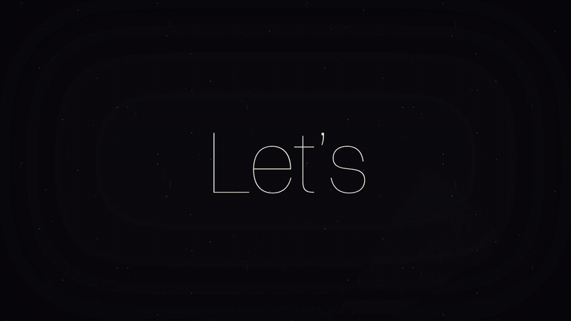

# Anti-Dopamine Bar



<sub>[The same video as an MP4](docs/demo.mp4), sharper.</sub>

A small macOS dock that separates the applications you work in from the ones designed to hold
your attention. Each application belongs to one mode; switching hides the applications of the
mode you leave and restores, all at once, those of the mode you enter.

Feeds and video sites run on variable reward, which makes a quick look easy to start and hard to
end. The third mode, Socials, therefore has a cost of entry: during a focus round it opens only
after a wait that lasts until the break. Steady clicking shortens it, each click by 15%, and five
seconds without a click puts it back. During a break, or with the timer paused, it opens freely,
and when the break ends the dock returns you to the mode you came from. The dock offers no streaks,
badges or other rewards of its own, since those would be a source of dopamine too. It is, in
short, a fairly *nuchter* piece of software: sober, practical, and not out to entertain you.

- **Modes**: Profile 1, Profile 2 and Socials by default. Rename them, change their icons, colours
  and apps in `~/.config/workspace-bar/config.json`. An app you open joins the mode you are in;
  right-click an icon to move it to another mode or share it with every mode. Browsers are shared
  with every mode from the start, so one browser serves them all; the extension (below) keeps
  social sites to Socials.
- **Pomodoro**: 25-minute focus rounds and 5-minute breaks. A break opens Socials, and so does
  pausing the timer; the end of a break, or resuming a focus round, takes you back to where you
  came from.
- **Cards**: hover a mode's button to see its top five apps and open one straight from there.
- **Add-ins** (the dock's menu, shown only for what is installed):
  - *Cmd-Tab for this mode only*: an AltTab-style switcher listing the current mode's apps.
  - *Option-1 to 3*: the first three modes from the keyboard.
  - *Raycast*: Raycast leaves out Socials' apps outside Socials (Raycast 1 and 2).
  - *Rectangle*: Rectangle's layouts leave room for the dock; its layouts on an app's right-click.
    Switched off, Rectangle gets its own bottom gap back.
  - *Brave, Chrome, Firefox*: the browser extension blocks social sites and YouTube outside
    Socials (below).
  - *Custom hooks*: your own scripts run on every switch (`~/.config/workspace-bar/hooks/`, see
    `example.sh.off` there). A script runs only if you own it and no one else can write to it.

## Build and install

Needs macOS 14 or later and the Xcode command line tools (`xcode-select --install`).

```sh
./build.sh               # builds, installs to ~/Applications and starts it at login (LaunchAgent)
./build.sh --no-install  # only builds build/AntiDopamineBar.app and the extension zips
```

On first start macOS asks for **Accessibility** (System Settings, Privacy & Security), which the
dock needs to hide, show and focus windows and to read Cmd-Tab and Option-1 to 3. The app is
signed ad hoc with a designated requirement on its identifier alone, so the permission survives
rebuilds; build it yourself rather than running a binary someone sends you.

The log is `~/Library/Logs/workspace-bar.log`. `tests/run.sh` runs the tests; `tests/sweep.md` lists
what is checked by hand.

## The browser extension

The extension in `extension/` keeps social media and YouTube closed unless Socials is open: you
are in Socials, on a break, or the timer is paused. A blocked page comes back by itself once it is.
With the dock not running, nothing is blocked. The sites are `socialSites` in the config.

To install it, choose **Show Browser Extension Folder** in the dock's menu, then:

- **Brave, Chrome, Edge, Arc**: on the browser's extensions page, turn on Developer mode, choose
  **Load unpacked** and pick the `chromium` folder.
- **Firefox**: in `about:debugging`, choose **Load Temporary Add-on** and pick
  `firefox/manifest.json`. It lasts until Firefox restarts.

Each browser can be switched off on its own in the dock's menu.

## Notes

- Turning off macOS's own Cmd-Tab and focusing another app's window rely on macOS calls Apple does
  not document, as AltTab does. Should a macOS version drop them, only those features stop working.
- The Raycast add-in edits Raycast's settings, so macOS asks once to let it read Raycast's key. It
  changes only what it added, and undoes that when switched off.

## Licence

GPL-3.0, see `LICENSE`. The window focusing in `main.swift` (`WindowServer`) follows
[AltTab](https://github.com/lwouis/alt-tab-macos) (GPL-3.0) by lwouis and contributors.
